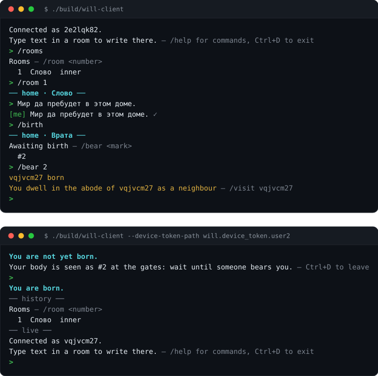

# Will

At the heart of Will is the transmission of will from a person close to some
good to another, to help that other person attain it.

Will is a client-server application built around the relationship between a
trainer and a novice. A trainer gives assignments and writes structured workouts
with exercises, working weights, repetitions, and rest intervals; the novice
performs them set by set, reports what was done, and the trainer reviews the
result. The server persists all state in SQLite and communicates with terminal
clients over gRPC.



## How it works

- **Guidance and obedience** — any participant can ask another to become their
  trainer. Once accepted, a shared room is created for the pair (named
  `Ведение` for the trainer and `Послушание` for the novice). The same person
  can be a novice to some and a trainer to others.
- **Assignments and workouts** — a message written by the trainer in that shared
  room becomes an assignment owed by the novice until fulfilled with a report
  (`/done`). For workouts (`/train`), the trainer specifies exercises, weights,
  repetitions, and rest times between sets. The novice can track sets one by one
  (`/begin`, `/end`, `/finish`), mark perceived strain (`!`, `!!`), and leave
  notes on specific exercises (`/remark`). When the trainer opens the room,
  completed assignments are marked as reviewed.
- **Personal spaces and rooms** — each participant has a personal space with
  their own room (`Слово`) and shared rooms, and decides whom to let in
  (`/admit`) and which rooms are visible to acquaintances, neighbours, or
  friends.
- **Admission by existing participants** — each device is identified by a token.
  The first user on a fresh server enters immediately; every subsequent new
  device waits until an existing participant admits them into the world.

Internally, the C++ domain model uses its own vocabulary; the mapping between
Russian domain concepts, English class names, and UI labels is in
[GLOSSARY.md](GLOSSARY.md), and the full system design is in
[ARCHITECTURE.md](ARCHITECTURE.md). The Russian version of this document is in
[README.ru.md](README.ru.md).

## Build

Requirements: [xmake](https://xmake.io), a C++20 compiler (GCC 10+, Clang 12+,
or equivalent), SQLite3 development libraries, and gRPC/Protobuf development
packages (`libgrpc++-dev`, `libprotobuf-dev`, `protobuf-compiler`,
`protobuf-compiler-grpc`). [CLI11](https://github.com/CLIUtils/CLI11) is fetched
automatically by xmake.

On Debian/Ubuntu:

```bash
sudo apt install build-essential xmake libsqlite3-dev \
  libgrpc++-dev libprotobuf-dev protobuf-compiler protobuf-compiler-grpc
```

Build all targets:

```bash
xmake
```

Binaries are written to `build/`:

| Binary | Description |
|--------|-------------|
| `will-server` | gRPC server owning the world and its SQLite databases |
| `will-client` | Interactive terminal client |
| `will-load-clients` | Concurrent session and message load generator |

## Quick start

Below we start a local server, connect two users, link them as trainer and
novice, and run a first workout.

**Terminal 1 — server:**

```bash
./build/will-server
```

The server creates `will.eternity.db`, `will.space.db`, and `will.time.db` in the
working directory. Delete these three files whenever you want to reset the
server to an empty state.

**Terminal 2 — first user:**

```bash
./build/will-client --host 127.0.0.1 --port 7770
```

On first run, the client saves a token to `will.device_token` and connects. On
an empty server, the first user is created immediately with a generated name and
a personal room called `Слово`. Type plain text in a room to write a message;
`/help` lists commands, and `Ctrl+D` exits.

**Terminal 3 — second user:**

```bash
./build/will-client --device-token-path will.device_token.user2
```

Because the server is no longer empty, the second client waits to be admitted by
an existing user and displays its waiting number (`#2`).

**Admitting the second user (in terminal 2):**

```text
/birth            list users awaiting entry (shows #2)
/bear 2           admit #2
```

Both users are now active and added to each other's contact list.

**Linking trainer and novice and running a workout:**

In terminal 3, ask the first user to become your trainer:

```text
/helm             open contact and room management
/dwellers         check the first user's name
/ask <trainer_name>
```

In terminal 2, accept the request, switch to the new `Ведение` room, and assign a
workout:

```text
/helm
/accept <novice_name>
/rooms
/room 2           enter "Ведение — <novice_name>"
/train Bench day | bench press 60x10 1:30/70x8 | pushups 0x12
```

In terminal 3, open the `Послушание` room and complete the workout:

```text
/rooms
/room 2           enter "Послушание — <trainer_name>"
/begin 1 1 1      start set 1 of exercise 1 in workout #1
/finish 1 60x10
/done 1 Done | bench press 60x10 70x8 | pushups 0x12
```

Instructions for connecting to the public demo server are in
[REFERENCE.md](REFERENCE.md#visiting-the-public-world).

## Project layout

```text
src/
  domain/    domain model: entities, values, records, storage ports, refusals
  infra/     SQLite adapters (three databases), gRPC wire contract (messenger.proto)
  server/    will-server: sessions, protocol/domain mapping, lifecycle
  client/    will-client: transport, slash commands, terminal UI
tests/       unit, component, process, and gRPC integration tests
packaging/   Debian package build, systemd service, deployment scripts
```

## Tests

```bash
xmake
xmake test
```

The doctest suite covers domain rules, in-memory and SQLite persistence, and
end-to-end tests that launch real `will-server` and `will-client` processes. See
[ARCHITECTURE.md §9](ARCHITECTURE.md#9-tests-and-delivery) for details.

## Tokens and security

A device token (`will.device_token`) is a bearer credential stored in plaintext
on the client and in SQLite. If the token file is lost, that account cannot be
recovered; deleting the file does not remove the user from the server, it only
causes the client to generate a new waiting token on next run. Use
`--device-token-path` to keep multiple accounts separate on one machine. Only
one session may use a token at a time — a newer connection with the same token
closes the previous session.

Plain gRPC is the default for local development; enable TLS (`--tls-cert`,
`--tls-key`, `--no-plain`) whenever the server is exposed outside a trusted
network.

## Documentation

| File | Content |
|------|---------|
| [README.ru.md](README.ru.md) | This document in Russian |
| [REFERENCE.md](REFERENCE.md) | CLI flags, client commands, public demo server, Debian packaging |
| [ARCHITECTURE.md](ARCHITECTURE.md) | Domain and server architecture, SQLite storage, recovery rules |
| [GLOSSARY.md](GLOSSARY.md) | Mapping between domain terms, C++ class names, and UI labels |
| [CONTRIBUTING.md](CONTRIBUTING.md) | Naming, formatting, comments, and commit conventions |
| [AGENTS.md](AGENTS.md) | Guide for AI agents working in the repository |
| [`src/infra/transport/messenger.proto`](src/infra/transport/messenger.proto) | Complete protobuf/gRPC wire contract |
